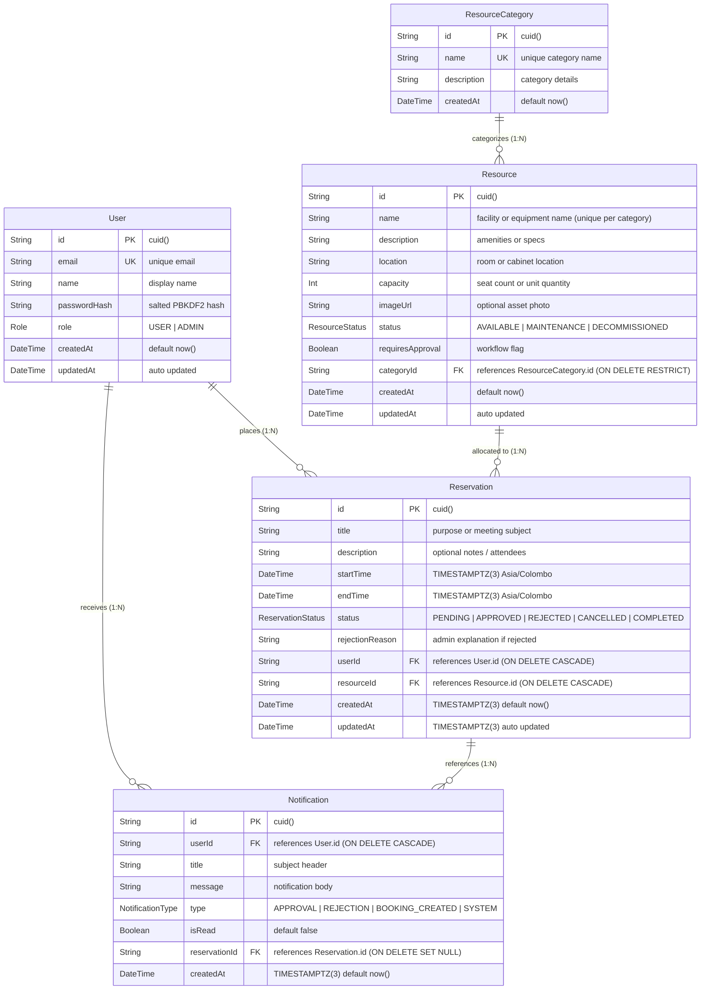

# Entity Relationship (ER) Diagram & Data Dictionary

**Project:** PrimeWave Reserve — Resource Reservation Management System  
**Organization:** PrimeWave Lab (Pvt) Ltd  
**Author:** Chanuka Vithanage  
**Database:** PostgreSQL 18 with Prisma ORM  

---

## 1. Visual Entity Relationship Diagram

GitHub renders the following Mermaid ER diagram natively:



> **Shareable Link for Official Assessment Submission Form:**  
> - **Interactive Mermaid Live Editor:** [https://mermaid.live/edit#pako:vZZRb6NGEMe_ymifclLuTm3f_EYwd6WxsWXwSa2Qqgk7treFXbI7JHXjfPdqweZwQnqtK9UPeFn-swz_-e3AkyiMJDERZKcKtxarXAMArB1ZOBzevzdPsCJH9gFZGQ0TyEVdYkEOrr6bJO9y8VqfGFYbVXwNsFSQehgNeerG_peyVXoLSsLyFnJRNEpe9eKBgCpUJay9ptHqvqFuZkSpsSLIhVSuLnHfno6oanTu0Vj5I7od5MJhySRheXM7_fQ97NDthjErUxJYf8jFOo1WcIBgOo-ToWaKTJmqCApLyCQD9knQBpuSQZvH86fq1U0tezU2bE4TJ_FzrrvBipxpbEEhMm2N3Q_q1M63nhfdRfXnS9tfRV9QgtbYYQWK02JveCzJFVbVLRF9bnuQxKhKd5l5r_x4i1csS-NvKYHNuBcXe5CLDRaqVLwHY4HuG1VXpPmf2YAVacWKnI91NRVuJKRNvdNbYyovLfBOaeL-0jAq1gwF1lj4lHLhCBkK02j2gY1WDPcNala8H7mXqnBLa1tCLkybJJaAzhFDvTNszvbB0bmUkRsHrvvLRfAliGfBzSyCA8yDOMmiJEhCfzaNwsV8HqdpvEii6XCtG2NKQg3W-2fJBXVtzQP6NB6N_X1TmkfYlLgdyfhEUizh023baTZkSfv29JLzD0r-z5u0h_Dtvthn-xLLPvYCMllx25_qxtbGka98RcT-kmvufqOCv4lmX35tmBx8BGQmLYnG96pjtNyOcpHF8yjNgvky--Xqh3cQOIUfQ1Oa6s6MxpKW_y5y4M5L-pZRMo2Tz74pL5erxZdoCgdYRT9FYdYOQ8_ibNaNF_PlLMrOUTyaYcm7pIxeEbpur8pKaaA_6hJ1Vxi1OcpIjqzQOLIjUPp33gcl4SoM0jCYRmPls0dw_4bpN5cYpfrc129iPS7vwT6j-AI6_4MzJ7CPFMOOUJIdEVbkHG69VA-zvTPyrO0NHyXb1wTsD7no4AlmPTzxIoED3CwWt3Hy-ddwFQUdT-nPaRbNx3qZcitCOWgpGyzd2CvBfqV5vOCnq605aZRBsp7NLi36s7gWFdkKlRSTJ8E7qvzH3zFJ8XzdNrV0rwsxYdvQtejIOH4bdpPPfwE](https://mermaid.live/edit#pako:vZZRb6NGEMe_ymifclLuTm3f_EYwd6WxsWXwSa2Qqgk7treFXbI7JHXjfPdqweZwQnqtK9UPeFn-swz_-e3AkyiMJDERZKcKtxarXAMArB1ZOBzevzdPsCJH9gFZGQ0TyEVdYkEOrr6bJO9y8VqfGFYbVXwNsFSQehgNeerG_peyVXoLSsLyFnJRNEpe9eKBgCpUJay9ptHqvqFuZkSpsSLIhVSuLnHfno6oanTu0Vj5I7od5MJhySRheXM7_fQ97NDthjErUxJYf8jFOo1WcIBgOo-ToWaKTJmqCApLyCQD9knQBpuSQZvH86fq1U0tezU2bE4TJ_FzrrvBipxpbEEhMm2N3Q_q1M63nhfdRfXnS9tfRV9QgtbYYQWK02JveCzJFVbVLRF9bnuQxKhKd5l5r_x4i1csS-NvKYHNuBcXe5CLDRaqVLwHY4HuG1VXpPmf2YAVacWKnI91NRVuJKRNvdNbYyovLfBOaeL-0jAq1gwF1lj4lHLhCBkK02j2gY1WDPcNala8H7mXqnBLa1tCLkybJJaAzhFDvTNszvbB0bmUkRsHrvvLRfAliGfBzSyCA8yDOMmiJEhCfzaNwsV8HqdpvEii6XCtG2NKQg3W-2fJBXVtzQP6NB6N_X1TmkfYlLgdyfhEUizh023baTZkSfv29JLzD0r-z5u0h_Dtvthn-xLLPvYCMllx25_qxtbGka98RcT-kmvufqOCv4lmX35tmBx8BGQmLYnG96pjtNyOcpHF8yjNgvky--Xqh3cQOIUfQ1Oa6s6MxpKW_y5y4M5L-pZRMo2Tz74pL5erxZdoCgdYRT9FYdYOQ8_ibNaNF_PlLMrOUTyaYcm7pIxeEbpur8pKaaA_6hJ1Vxi1OcpIjqzQOLIjUPp33gcl4SoM0jCYRmPls0dw_4bpN5cYpfrc129iPS7vwT6j-AI6_4MzJ7CPFMOOUJIdEVbkHG69VA-zvTPyrO0NHyXb1wTsD7no4AlmPTzxIoED3CwWt3Hy-ddwFQUdT-nPaRbNx3qZcitCOWgpGyzd2CvBfqV5vOCnq605aZRBsp7NLi36s7gWFdkKlRSTJ8E7qvzH3zFJ8XzdNrV0rwsxYdvQtejIOH4bdpPPfwE)  
> - **Full-Screen SVG Diagram View:** [https://mermaid.live/view#pako:vZZRb6NGEMe_ymifclLuTm3f_EYwd6WxsWXwSa2Qqgk7treFXbI7JHXjfPdqweZwQnqtK9UPeFn-swz_-e3AkyiMJDERZKcKtxarXAMArB1ZOBzevzdPsCJH9gFZGQ0TyEVdYkEOrr6bJO9y8VqfGFYbVXwNsFSQehgNeerG_peyVXoLSsLyFnJRNEpe9eKBgCpUJay9ptHqvqFuZkSpsSLIhVSuLnHfno6oanTu0Vj5I7od5MJhySRheXM7_fQ97NDthjErUxJYf8jFOo1WcIBgOo-ToWaKTJmqCApLyCQD9knQBpuSQZvH86fq1U0tezU2bE4TJ_FzrrvBipxpbEEhMm2N3Q_q1M63nhfdRfXnS9tfRV9QgtbYYQWK02JveCzJFVbVLRF9bnuQxKhKd5l5r_x4i1csS-NvKYHNuBcXe5CLDRaqVLwHY4HuG1VXpPmf2YAVacWKnI91NRVuJKRNvdNbYyovLfBOaeL-0jAq1gwF1lj4lHLhCBkK02j2gY1WDPcNala8H7mXqnBLa1tCLkybJJaAzhFDvTNszvbB0bmUkRsHrvvLRfAliGfBzSyCA8yDOMmiJEhCfzaNwsV8HqdpvEii6XCtG2NKQg3W-2fJBXVtzQP6NB6N_X1TmkfYlLgdyfhEUizh023baTZkSfv29JLzD0r-z5u0h_Dtvthn-xLLPvYCMllx25_qxtbGka98RcT-kmvufqOCv4lmX35tmBx8BGQmLYnG96pjtNyOcpHF8yjNgvky--Xqh3cQOIUfQ1Oa6s6MxpKW_y5y4M5L-pZRMo2Tz74pL5erxZdoCgdYRT9FYdYOQ8_ibNaNF_PlLMrOUTyaYcm7pIxeEbpur8pKaaA_6hJ1Vxi1OcpIjqzQOLIjUPp33gcl4SoM0jCYRmPls0dw_4bpN5cYpfrc129iPS7vwT6j-AI6_4MzJ7CPFMOOUJIdEVbkHG69VA-zvTPyrO0NHyXb1wTsD7no4AlmPTzxIoED3CwWt3Hy-ddwFQUdT-nPaRbNx3qZcitCOWgpGyzd2CvBfqV5vOCnq605aZRBsp7NLi36s7gWFdkKlRSTJ8E7qvzH3zFJ8XzdNrV0rwsxYdvQtejIOH4bdpPPfwE](https://mermaid.live/view#pako:vZZRb6NGEMe_ymifclLuTm3f_EYwd6WxsWXwSa2Qqgk7treFXbI7JHXjfPdqweZwQnqtK9UPeFn-swz_-e3AkyiMJDERZKcKtxarXAMArB1ZOBzevzdPsCJH9gFZGQ0TyEVdYkEOrr6bJO9y8VqfGFYbVXwNsFSQehgNeerG_peyVXoLSsLyFnJRNEpe9eKBgCpUJay9ptHqvqFuZkSpsSLIhVSuLnHfno6oanTu0Vj5I7od5MJhySRheXM7_fQ97NDthjErUxJYf8jFOo1WcIBgOo-ToWaKTJmqCApLyCQD9knQBpuSQZvH86fq1U0tezU2bE4TJ_FzrrvBipxpbEEhMm2N3Q_q1M63nhfdRfXnS9tfRV9QgtbYYQWK02JveCzJFVbVLRF9bnuQxKhKd5l5r_x4i1csS-NvKYHNuBcXe5CLDRaqVLwHY4HuG1VXpPmf2YAVacWKnI91NRVuJKRNvdNbYyovLfBOaeL-0jAq1gwF1lj4lHLhCBkK02j2gY1WDPcNala8H7mXqnBLa1tCLkybJJaAzhFDvTNszvbB0bmUkRsHrvvLRfAliGfBzSyCA8yDOMmiJEhCfzaNwsV8HqdpvEii6XCtG2NKQg3W-2fJBXVtzQP6NB6N_X1TmkfYlLgdyfhEUizh023baTZkSfv29JLzD0r-z5u0h_Dtvthn-xLLPvYCMllx25_qxtbGka98RcT-kmvufqOCv4lmX35tmBx8BGQmLYnG96pjtNyOcpHF8yjNgvky--Xqh3cQOIUfQ1Oa6s6MxpKW_y5y4M5L-pZRMo2Tz74pL5erxZdoCgdYRT9FYdYOQ8_ibNaNF_PlLMrOUTyaYcm7pIxeEbpur8pKaaA_6hJ1Vxi1OcpIjqzQOLIjUPp33gcl4SoM0jCYRmPls0dw_4bpN5cYpfrc129iPS7vwT6j-AI6_4MzJ7CPFMOOUJIdEVbkHG69VA-zvTPyrO0NHyXb1wTsD7no4AlmPTzxIoED3CwWt3Hy-ddwFQUdT-nPaRbNx3qZcitCOWgpGyzd2CvBfqV5vOCnq605aZRBsp7NLi36s7gWFdkKlRSTJ8E7qvzH3zFJ8XzdNrV0rwsxYdvQtejIOH4bdpPPfwE)

---

## 2. Data Dictionary

### Table: `users`
Represents individuals interacting with the system (Regular Members / Interns and Platform Administrators).

| Column | Type | Constraints | Description |
| :--- | :--- | :--- | :--- |
| `id` | `VARCHAR(30)` | **PRIMARY KEY** (`cuid()`) | Unique alphanumeric identifier. |
| `email` | `VARCHAR(255)` | **UNIQUE, NOT NULL** | Work email address. |
| `name` | `VARCHAR(255)` | **NOT NULL** | User full name. |
| `passwordHash` | `TEXT` | **NOT NULL** | Salted PBKDF2 hash of the password. |
| `role` | `ENUM ('USER', 'ADMIN')` | **NOT NULL**, Default: `'USER'` | Access control role. |
| `createdAt` | `TIMESTAMP` | **NOT NULL**, Default: `now()` | Account creation timestamp. |
| `updatedAt` | `TIMESTAMP` | **NOT NULL**, Auto-updated | Last profile modification timestamp. |

---

### Table: `resource_categories`
Groups organizational resources into logical classifications (Meeting Rooms, Media Hardware, Labs).

| Column | Type | Constraints | Description |
| :--- | :--- | :--- | :--- |
| `id` | `VARCHAR(30)` | **PRIMARY KEY** (`cuid()`) | Unique category identifier. |
| `name` | `VARCHAR(100)` | **UNIQUE, NOT NULL** | Name of category (e.g. "Meeting & Conference Rooms"). |
| `description` | `TEXT` | `NULLABLE` | Explanation of resources in this category. |
| `createdAt` | `TIMESTAMP` | **NOT NULL**, Default: `now()` | Category creation timestamp. |

---

### Table: `resources`
The core physical assets, meeting spaces, and equipment shared across teams.

| Column | Type | Constraints | Description |
| :--- | :--- | :--- | :--- |
| `id` | `VARCHAR(30)` | **PRIMARY KEY** (`cuid()`) | Unique resource identifier. |
| `name` | `VARCHAR(255)` | **NOT NULL**, Compound **UNIQUE** `("categoryId", "name")` | Resource display name. Guaranteed unique within its parent category. |
| `description` | `TEXT` | `NULLABLE` | Equipment specs, seating capacity, or instructions. |
| `location` | `VARCHAR(255)` | `NULLABLE` | Physical room, floor, or storage cabinet. |
| `capacity` | `INTEGER` | **NOT NULL**, Default: `1` | Seating capacity or unit quantity available. |
| `imageUrl` | `TEXT` | `NULLABLE` | Photo reference. |
| `status` | `ENUM ('AVAILABLE', 'MAINTENANCE', 'DECOMMISSIONED')` | **NOT NULL**, Default: `'AVAILABLE'` | Real-time operational state. |
| `requiresApproval`| `BOOLEAN` | **NOT NULL**, Default: `false` | If `true`, reservations require admin confirmation. |
| `categoryId` | `VARCHAR(30)` | **FOREIGN KEY** &rarr; `resource_categories.id` (**`ON DELETE RESTRICT`**) | References parent category. Deletion of category is rejected if resources exist, eliminating orphaned resources. |
| `createdAt` | `TIMESTAMP(3)` | **NOT NULL**, Default: `now()` | Timestamp added. |
| `updatedAt` | `TIMESTAMP(3)` | **NOT NULL**, Auto-updated | Last modified. |

---

### Table: `reservations`
Booked time slots for shared resources. Stored with explicit microsecond timezone instants (`TIMESTAMPTZ(3)`) locked to the organization's timezone (`Asia/Colombo` / UTC+05:30).

| Column | Type | Constraints | Description |
| :--- | :--- | :--- | :--- |
| `id` | `VARCHAR(30)` | **PRIMARY KEY** (`cuid()`) | Unique booking identifier. |
| `title` | `VARCHAR(255)` | **NOT NULL** | Purpose of booking (e.g. "Sprint Planning"). |
| `description` | `TEXT` | `NULLABLE` | Meeting agenda or equipment requirements. |
| `startTime` | `TIMESTAMPTZ(3)` | **NOT NULL** | Reserved start instant in `Asia/Colombo`. |
| `endTime` | `TIMESTAMPTZ(3)` | **NOT NULL** | Reserved end instant in `Asia/Colombo`. |
| `status` | `ENUM ('PENDING', 'APPROVED', 'REJECTED', 'CANCELLED', 'COMPLETED')` | **NOT NULL**, Default: `'PENDING'` | Lifecycle status of booking across 5 authoritative states. |
| `rejectionReason` | `TEXT` | `NULLABLE` | Feedback if rejected by admin. Mandatory on rejection. |
| `userId` | `VARCHAR(30)` | **FOREIGN KEY** &rarr; `users.id` (`ON DELETE CASCADE`) | User who reserved. |
| `resourceId` | `VARCHAR(30)` | **FOREIGN KEY** &rarr; `resources.id` (`ON DELETE CASCADE`) | Resource being reserved. |
| `createdAt` | `TIMESTAMPTZ(3)` | **NOT NULL**, Default: `now()` | When booking was submitted. |
| `updatedAt` | `TIMESTAMPTZ(3)` | **NOT NULL**, Auto-updated | Status transition timestamp. |

---

### Table: `notifications`
Durable in-app notification records dispatched upon reservation submission, administrative approvals, or rejections.

| Column | Type | Constraints | Description |
| :--- | :--- | :--- | :--- |
| `id` | `VARCHAR(30)` | **PRIMARY KEY** (`cuid()`) | Unique notification identifier. |
| `userId` | `VARCHAR(30)` | **FOREIGN KEY** &rarr; `users.id` (`ON DELETE CASCADE`) | Recipient user ID. |
| `title` | `VARCHAR(255)` | **NOT NULL** | Subject header (e.g. "Reservation Approved"). |
| `message` | `TEXT` | **NOT NULL** | Detailed notification payload or admin feedback. |
| `type` | `ENUM ('APPROVAL', 'REJECTION', 'BOOKING_CREATED', 'SYSTEM')` | **NOT NULL**, Default: `'SYSTEM'` | Notification classification. |
| `isRead` | `BOOLEAN` | **NOT NULL**, Default: `false` | Read receipt indicator. |
| `reservationId` | `VARCHAR(30)` | **FOREIGN KEY** &rarr; `reservations.id` (`ON DELETE SET NULL`) | Associated reservation reference. |
| `createdAt` | `TIMESTAMPTZ(3)` | **NOT NULL**, Default: `now()` | Generation timestamp. |

---

## 3. Database Indexes for Performance & Concurrency

1. **PostgreSQL GiST Exclusion Constraint with `tstzrange` (Hardware-Level Concurrency & Timezone Safety):**
   ```sql
   CREATE EXTENSION IF NOT EXISTS btree_gist;

   ALTER TABLE "reservations"
   ADD CONSTRAINT "no_overlapping_active_reservations"
   EXCLUDE USING gist (
     "resourceId" WITH =,
     tstzrange("startTime", "endTime", '[)') WITH &&
   )
   WHERE ("status" IN ('PENDING', 'APPROVED'));
   ```
   *Rationale:* Solves race conditions under high concurrent booking traffic across global and local timezones. Uses `tstzrange` with half-open intervals `'[)'` to ensure adjacent bookings (e.g., 10:00–11:00 followed by 11:00–12:00) are cleanly permitted, while true overlaps are physically rejected by the PostgreSQL storage engine with error `23P01 (exclusion_violation)`.

2. **Composite B-Tree Application Index:**
   ```sql
   CREATE INDEX "reservations_resourceId_startTime_endTime_idx" 
   ON "reservations" ("resourceId", "startTime", "endTime");
   ```
   *Rationale & Query Planner Characteristics:*  
   - Filters candidate reservations by exact equality on `resourceId` and establishes a starting boundary on `startTime`.
   - *Technical Nuance on Range Complexity:* Because the double-booking check applies inequalities across two distinct columns (`existing.startTime < newEnd AND existing.endTime > newStart`), a B-tree cannot perform a pure $O(\log N)$ point search on `endTime`. The query engine scans matching `resourceId` and `startTime` index entries and evaluates `endTime` as a candidate filter condition.
   - *Empirical Analysis:* In moderate-sized datasets (1,000+ rows), PostgreSQL's cost-based optimizer may favor reading cached shared buffers directly (`Seq Scan` over ~23 buffer pages) or a `Bitmap Index Scan`. Full query plans and buffer analysis are documented in [docs/INDEXING_BENCHMARK.md](docs/INDEXING_BENCHMARK.md).
   - *Separation of Concerns:* The B-tree optimizes application read paths, whereas the GiST exclusion constraint guarantees **correctness under concurrency** (preventing race conditions at the ACID storage engine level).

3. **User Dashboard Index:**
   ```sql
   CREATE INDEX "reservations_userId_idx" ON "reservations" ("userId");
   ```
   *Rationale:* Optimizes "My Reservations" queries for instant loading.

4. **Status Queue Index:**
   ```sql
   CREATE INDEX "reservations_status_idx" ON "reservations" ("status");
   ```
   *Rationale:* Accelerates the Administrator Pending Approval queue.

5. **Resource Scoped Uniqueness Index:**
   ```sql
   CREATE UNIQUE INDEX "resources_categoryId_name_key" ON "resources" ("categoryId", "name");
   ```
   *Rationale:* Enforces scoped name uniqueness per category at the physical storage layer.

6. **Notification Inboxes & Real-Time Query Indexes:**
   ```sql
   CREATE INDEX "notifications_userId_isRead_idx" ON "notifications" ("userId", "isRead");
   CREATE INDEX "notifications_userId_createdAt_idx" ON "notifications" ("userId", "createdAt");
   ```
   *Rationale:* Powers instant unread notification badge counts (`userId, isRead`) and chronological notification history feeds (`userId, createdAt`).

---

## 4. Architectural Integrity & Schema Invariants (Assessment Finding 6 Alignment)

To eliminate documentation divergence and ensure institutional reliability across all artifacts, the following invariants are enforced:

### 1. Single Authoritative Source of Truth
The Prisma schema file ([prisma/schema.prisma](prisma/schema.prisma)) is the sole source of truth for the database structure. Both the Visual ER Diagram (Mermaid), the Interactive Live Editor link, the Data Dictionary, and the project [README.md](README.md) are derived directly from this schema. All 5 `ReservationStatus` enum values (`PENDING`, `APPROVED`, `REJECTED`, `CANCELLED`, `COMPLETED`) and all model attributes are 100% synchronized across every document.

### 2. Category Cascade Policy & Orphan Prevention
- **Decision:** Category deletion employs `onDelete: Restrict` in PostgreSQL foreign key constraints (`category ResourceCategory @relation(fields: [categoryId], references: [id], onDelete: Restrict)`).
- **Guarantee:** An administrator cannot accidentally delete a `ResourceCategory` if resources are currently linked to it. The relational engine raises a foreign key violation (`23503`), preventing orphaned resources and preserving audit trails for historical bookings.

### 3. Resource Name Uniqueness Scope
- **Decision:** Resource names are unique **within their respective category** (`@@unique([categoryId, name])`), rather than globally unique.
- **Rationale:** Different departments or categories may share common equipment designations (e.g., both "Conference Rooms" and "Laboratories" may host a "Pod 1" or "Screen 01"). Scoping uniqueness to `(categoryId, name)` prevents accidental duplicates within the same department while allowing autonomous naming conventions across distinct organizational categories.

### 4. Clean-Slate Migration Pipeline Reproducibility
The database migration pipeline is strictly version-controlled via Prisma Migrate and consists of sequential, deterministic SQL migrations:
1. `20261012214214_init`: Initial table structures, foreign keys, and indexes.
2. `20261013101500_add_exclusion_constraint`: PostgreSQL `btree_gist` extension and GiST exclusion constraint for concurrency safety.
3. `20261013110000_update_timestamptz`: Standardized `TIMESTAMPTZ(3)` microsecond precision with timezone support.
4. `20261013120000_add_resource_category_unique_constraint`: Scoped unique constraint on `("categoryId", "name")`.

Executing `npx prisma migrate reset` or `npx prisma migrate deploy` on any clean PostgreSQL instance deterministically reconstructs the production database without drift or manual intervention.

