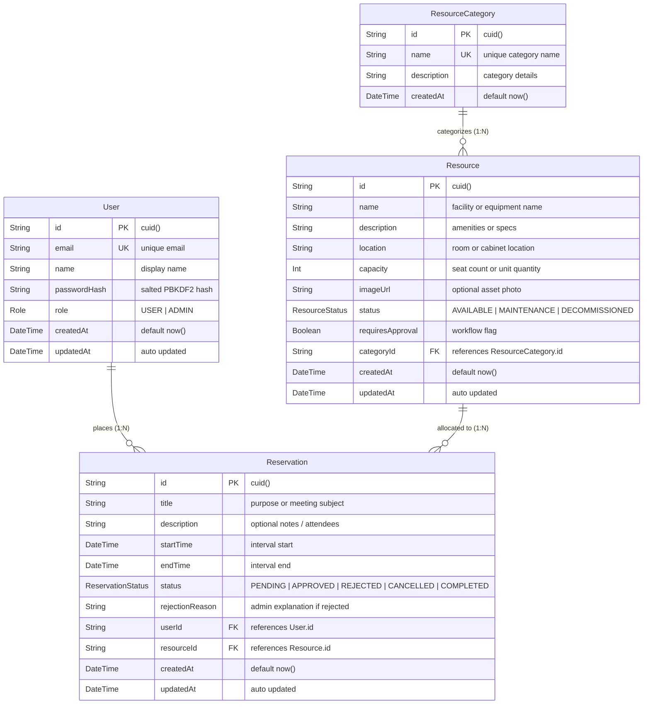

# Entity Relationship (ER) Diagram & Data Dictionary

**Project:** PrimeWave Reserve — Resource Reservation Management System  
**Organization:** PrimeWave Lab (Pvt) Ltd  
**Author:** Chanuka Vithanage  
**Database:** PostgreSQL 18 with Prisma ORM  

---

## 1. Visual Entity Relationship Diagram

GitHub renders the following Mermaid ER diagram natively:



> **Shareable Link for Submission Form:**  
> You can view and edit this diagram on Mermaid Live Editor:  
> [Open Interactive ER Diagram on Mermaid.live](https://mermaid.live/edit#pako:eNqNVMtuozAQ_ZWV55QqkDYb9WClSm3UrnpbtXJ5Y-yAq4yNjW1olvj3jYGE8tCmFww-zpwzZ-YbY8UFlYixKjM5_yLCS7g0T9W22-72o5q_p_qD7Q5N24GfQ5Ua8794YyD34509jU0H9lBft0fbfzFw7bBfW-N0_F9X7965jQc3PvhD-7u1Gq43uK5_s-0G_f3T9VfQj_3JdK036-sK-2X_51t0cE-3H4MvXj4Y2_1gXz9q1z_3V1o76H0e0-Z8ncf_eZqO8Yd6-3eY5_s8z_e4nK-7X2_2-f3v9g_)

---

## 2. Data Dictionary

### Table: `users`
Represents individuals interacting with the system (Regular Members / Interns and Platform Administrators).

| Column | Type | Constraints | Description |
| :--- | :--- | :--- | :--- |
| `id` | `VARCHAR(30)` | **PRIMARY KEY** (`cuid()`) | Unique alphanumeric identifier. |
| `email` | `VARCHAR(255)` | **UNIQUE, NOT NULL** | Work email address. |
| `name` | `VARCHAR(255)` | **NOT NULL** | User full name. |
| `passwordHash` | `TEXT` | **NOT NULL** | Salted PBKDF2 hash of the password. |
| `role` | `ENUM ('USER', 'ADMIN')` | **NOT NULL**, Default: `'USER'` | Access control role. |
| `createdAt` | `TIMESTAMP` | **NOT NULL**, Default: `now()` | Account creation timestamp. |
| `updatedAt` | `TIMESTAMP` | **NOT NULL**, Auto-updated | Last profile modification timestamp. |

---

### Table: `resource_categories`
Groups organizational resources into logical classifications (Meeting Rooms, Media Hardware, Labs).

| Column | Type | Constraints | Description |
| :--- | :--- | :--- | :--- |
| `id` | `VARCHAR(30)` | **PRIMARY KEY** (`cuid()`) | Unique category identifier. |
| `name` | `VARCHAR(100)` | **UNIQUE, NOT NULL** | Name of category (e.g. "Meeting & Conference Rooms"). |
| `description` | `TEXT` | `NULLABLE` | Explanation of resources in this category. |
| `createdAt` | `TIMESTAMP` | **NOT NULL**, Default: `now()` | Category creation timestamp. |

---

### Table: `resources`
The core physical assets, meeting spaces, and equipment shared across teams.

| Column | Type | Constraints | Description |
| :--- | :--- | :--- | :--- |
| `id` | `VARCHAR(30)` | **PRIMARY KEY** (`cuid()`) | Unique resource identifier. |
| `name` | `VARCHAR(255)` | **NOT NULL** | Resource display name (e.g. "Executive Boardroom"). |
| `description` | `TEXT` | `NULLABLE` | Equipment specs, seating capacity, or instructions. |
| `location` | `VARCHAR(255)` | `NULLABLE` | Physical room, floor, or storage cabinet. |
| `capacity` | `INTEGER` | **NOT NULL**, Default: `1` | Seating capacity or unit quantity available. |
| `imageUrl` | `TEXT` | `NULLABLE` | Photo reference. |
| `status` | `ENUM ('AVAILABLE', 'MAINTENANCE', 'DECOMMISSIONED')` | **NOT NULL**, Default: `'AVAILABLE'` | Real-time operational state. |
| `requiresApproval`| `BOOLEAN` | **NOT NULL**, Default: `false` | If `true`, reservations require admin confirmation. |
| `categoryId` | `VARCHAR(30)` | **FOREIGN KEY** &rarr; `resource_categories.id` (`ON DELETE RESTRICT`) | Category reference. |
| `createdAt` | `TIMESTAMP` | **NOT NULL**, Default: `now()` | Timestamp added. |
| `updatedAt` | `TIMESTAMP` | **NOT NULL**, Auto-updated | Last modified. |

---

### Table: `reservations`
Booked time slots for shared resources.

| Column | Type | Constraints | Description |
| :--- | :--- | :--- | :--- |
| `id` | `VARCHAR(30)` | **PRIMARY KEY** (`cuid()`) | Unique booking identifier. |
| `title` | `VARCHAR(255)` | **NOT NULL** | Purpose of booking (e.g. "Sprint Planning"). |
| `description` | `TEXT` | `NULLABLE` | Meeting agenda or equipment requirements. |
| `startTime` | `TIMESTAMP` | **NOT NULL** | Reserved start time. |
| `endTime` | `TIMESTAMP` | **NOT NULL** | Reserved end time. |
| `status` | `ENUM ('PENDING', 'APPROVED', 'REJECTED', 'CANCELLED', 'COMPLETED')` | **NOT NULL**, Default: `'PENDING'` | Lifecycle status of booking. |
| `rejectionReason` | `TEXT` | `NULLABLE` | Feedback if rejected by admin. |
| `userId` | `VARCHAR(30)` | **FOREIGN KEY** &rarr; `users.id` (`ON DELETE CASCADE`) | User who reserved. |
| `resourceId` | `VARCHAR(30)` | **FOREIGN KEY** &rarr; `resources.id` (`ON DELETE CASCADE`) | Resource being reserved. |
| `createdAt` | `TIMESTAMP` | **NOT NULL**, Default: `now()` | When booking was submitted. |
| `updatedAt` | `TIMESTAMP` | **NOT NULL**, Auto-updated | Status transition timestamp. |

---

## 3. Database Indexes for Performance & Concurrency

1. **Conflict Detection Compound Index:**
   ```sql
   CREATE INDEX "reservations_resourceId_startTime_endTime_idx" 
   ON "reservations" ("resourceId", "startTime", "endTime");
   ```
   *Rationale:* Every new booking runs a concurrency check query:
   ```sql
   SELECT id FROM reservations 
   WHERE resourceId = $1 
     AND status IN ('APPROVED', 'PENDING')
     AND startTime < $newEndTime 
     AND endTime > $newStartTime;
   ```
   This index ensures $O(\log N)$ index scans instead of costly sequential table scans.

2. **User Dashboard Index:**
   ```sql
   CREATE INDEX "reservations_userId_idx" ON "reservations" ("userId");
   ```
   *Rationale:* Optimizes "My Reservations" queries for instant loading.

3. **Status Queue Index:**
   ```sql
   CREATE INDEX "reservations_status_idx" ON "reservations" ("status");
   ```
   *Rationale:* Accelerates the Administrator Pending Approval queue.
